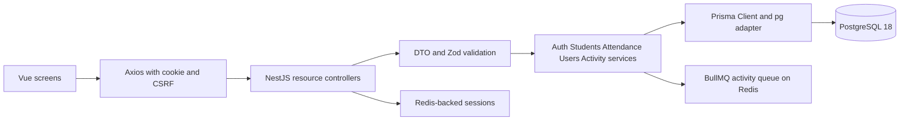
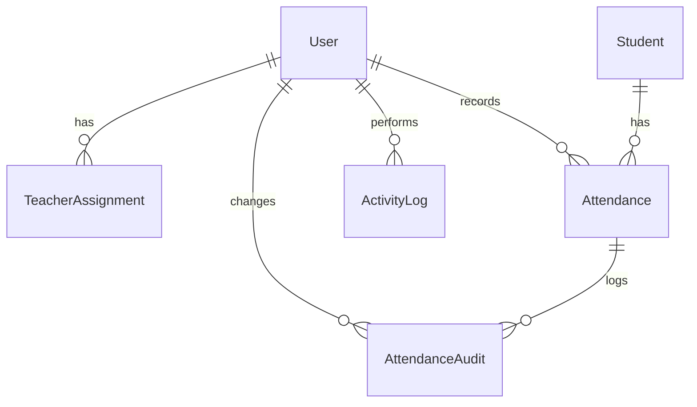

# School ERP Technical Design and Handover

Candidate: Saurabh · Version: 1.1 · Verified 11 October 2026 · Vue 3, NestJS 12, Prisma 7, PostgreSQL 18, Redis

This document describes the submitted School ERP module and the checks run against it. It covers student records, attendance, fee follow-up, Admin and Teacher permissions, staff management, and activity history. The fresh seed and live API smoke checks passed on a local PostgreSQL and Redis setup; remaining limits are stated below.

## 1. Executive summary and scope

Admins can create and edit students, view outstanding fees, record or correct attendance, manage staff and class assignments, and review all activity. Teachers see assigned classes and can record or correct attendance for those students. The UI includes responsive tables, filters, modals, validation feedback, and skeleton loading. Admission numbers are server-generated. The assignment's payment gateway, fee ledger, invoices, branch support, CSV export, and production operations are outside this implementation. Names and contact details in the seed are fictional.

## 2. Technology stack and rationale

| Layer | Implementation | Reason |
| --- | --- | --- |
| Frontend | Vue 3 Options API, Vite, Vue Router, Pinia, Axios | Modular screens, session state, API client, lazy routes |
| UI | Tailwind, SCSS, Vue Final Modal, Popper, vue-toastification, Moment | Responsive components, accessible positioning, user feedback |
| Backend | Node.js 24, NestJS 12, TypeScript, DTOs and Zod | Resource modules and runtime validation |
| Persistence | Prisma 7 with PostgreSQL 18 | Relational constraints, typed queries, UUIDv7 IDs |
| Authentication | bcrypt, Redis-backed express-session, CSRF | Server-controlled sessions and protected writes |
| Verification | Vitest and real HTTP/database smoke scripts | Fast rule checks plus integration evidence |

A server-rendered UI was an alternative, but the provided Vue/Nest starter and the requested Options API favoured a separate frontend and API. Redis is used for sessions and the configured BullMQ worker, not to cache student lists.

The frontend uses Vue Final Modal, vue-select, v-wave, vue-toastification, vue3-click-away, Moment, and Floating Vue tooltips. The supplied Lottie file is used for full-page loading; tables show lightweight skeletons. A server-rendered application was considered, but Vue and NestJS align with the supplied starter projects and make the API permission boundary explicit.

## 3. Architecture and request flow

For a teacher recording attendance, the UI sends a student ID, date, and status. The controller validates the body. `AttendanceService` loads the student, checks that the teacher has the student's class/section assignment, rejects inactive students, then creates attendance and audit rows in one transaction. A database unique index on `(studentId, date)` rejects concurrent duplicate requests. The service translates that constraint error to HTTP 409. NestJS returns validation errors as 400, missing rows as 404, missing sessions as 401, and forbidden class access as 403.

For an attendance mark, the UI sends student ID, ISO date and status. DTO and Zod validation reject malformed input. The service loads the student, checks the current user's assigned class, and writes attendance, correction audit where relevant, and activity in a transaction. PostgreSQL's unique `(studentId, date)` index resolves concurrent duplicate attempts; the API returns 409. Validation, missing, unauthenticated and forbidden cases return 400, 404, 401 and 403 respectively.

## 4. Data model and constraints

| Entity | Key fields and relationships | Constraint or index |
| --- | --- | --- |
| User | UUIDv7 ID, unique email, password hash, role, active, optional gender/phone | Unique email; role/active/name index |
| TeacherAssignment | User FK, grade, section | Unique teacher/grade/section |
| Student | UUIDv7 ID, admission number, name, optional gender/email/phone, grade, section, guardian, active, fee status, decimal due | Unique admission; class/name and fee/class indexes; fee/due SQL check |
| Attendance | Student and recording-user FKs, date, status | Unique student/date; date/status index |
| AttendanceAudit | Attendance and changing-user FKs, old/new status, timestamp | Attendance/time index |
| ActivityLog | Actor FK, action, entity, summary, safe details, timestamp | Time and actor/time indexes |

The API allocates `SCH-YYYY-NNNNNN` from a PostgreSQL sequence and does not accept an admission number in a create request. Seeded sample records use fixed demo numbers. PostgreSQL uniqueness remains the final protection against duplicates. Money is stored as `DECIMAL(12,2)`; Paid requires zero due and outstanding statuses require positive due.

## 5. API reference

All paths below have the `/api` prefix. Lists return `items`, `total`, `page`, `per_page`, and `total_pages`; `per_page` is capped at 100.

| Method and path | Purpose and key input | Access | Success; typical errors |
| --- | --- | --- | --- |
| `POST /auth/login` | Email/password, start session | Public | 201; 400, 401 |
| `GET /auth/profile` | Current user, role and assignments | Signed in | 200; 401 |
| `POST /auth/logout` | End session | Signed in | 201; 401 |
| `GET /students`, `GET /students/:id` | Search by name/admission; grade, section, page | Admin; Teacher in assigned classes | 200; 400, 401, 403, 404 |
| `POST /students`, `PATCH /students/:id` | Student details, contacts, fee status/due | Admin | 201/200; 400, 401, 403, 404, 409 |
| `GET /students/dues` | Search outstanding amounts | Admin | 200; 400, 401, 403 |
| `GET /attendance` | Grade, section, date, page; class totals | Admin; assigned Teacher | 200; 400, 401, 403 |
| `POST /attendance`, `PUT /attendance/:id` | Student/date/status; correct with new status | Admin; assigned Teacher | 201/200; 400, 401, 403, 404, 409 |
| `GET /attendance/student/:studentId` | Paged individual history | Admin; assigned Teacher | 200; 401, 403, 404 |
| `GET /users`, `GET /users/stats`, `GET /users/:id` | Staff directory, counts, detail | Admin | 200; 401, 403, 404 |
| `POST /users`, `PATCH /users/:id` | Staff account, role, class assignments | Admin | 201/200; 400, 401, 403, 404, 409 |
| `GET /activity` | Search, actor/role and inclusive date filters | Admin all; Teacher own | 200; 400, 401 |

Examples: `GET /api/students?q=aar&grade=8&section=A`; `POST /api/attendance` with `{ "studentId": "<uuid>", "date": "2026-10-12", "status": "PRESENT" }`; `PUT /api/attendance/<id>` with `{ "status": "LATE" }`; `GET /api/attendance/student/<id>?page=1&per_page=20`; `GET /api/students/dues?q=diya`.

## 6. Authentication and authorisation

Login regenerates an eight-hour Redis session. Its HTTP-only, SameSite=Lax cookie carries a session ID; the profile endpoint returns the current user and `x-csrf-token`. The Axios client sends cookies and the token on writes. The server reloads active status and assignments from PostgreSQL on authenticated requests, so deactivation takes effect without waiting for a client refresh. Admin-only service methods reject Teachers. Student detail/history and attendance operations check the server-loaded student's current grade and section; lists add the assignment predicate to the database query. Changing a URL or request payload cannot bypass these checks. Teachers do not receive fee fields.

## 7. Local setup and operation

Use Node.js 24.12+, npm 11+, PostgreSQL 18 and Redis. Set `DATABASE_URL`, `REDIS_URL`, `SESSION_SECRET` of at least 32 random characters, `FRONTEND_ORIGIN`, and optional `PORT` in `backend/.env` from `.env.example`. Keep credentials out of source control. From `backend`, run `npm ci`, `npm run db:migrate`, `npm run db:seed`, `npm run start:dev`. From `frontend`, run `npm ci`, `npm run dev`; visit `http://localhost:5173`. The development proxy expects the backend on port 3000. If that port is occupied, stop the other process or change both the backend port and Vite proxy target.

The seed creates one Admin (`admin@school.local`), Teachers for 8/A (`teacher@school.local`) and 9/B (`teacher9@school.local`), 12 fictional students with contacts, and 30 attendance marks across three dates. The default **local-only** password is `SchoolDemo!2026`, overridable through `DEMO_PASSWORD` before seeding. Repeated seeding does not duplicate these records. A fresh database needs migrations before seeding. `npm run test:seed` checks migrations and two seed runs in a temporary database, then drops only that temporary database; the database user needs creation rights.

## 8. Test plan and results

The earlier handover's “12 tests” and “not freshly verified” statements predate this revision. The results below come from the submitted source on 12 October 2026. Backend Vitest: **24 passed / 9 files**. Frontend route tests: **3 passed**. Backend and frontend production builds passed. The backend lint command exited successfully but emitted unused-import warnings in older resource files. The live HTTP smoke test passed against local PostgreSQL and Redis. The fresh-seed test passed after two seed runs. A separate full `tsc --noEmit` check still reports errors in older `src/http.spec.ts` and `src/rules.spec.ts`; the normal Nest build excludes those spec files.

| Test case | Expected result | Actual result and status |
| --- | --- | --- |
| Create/search students; admission uniqueness | New API records receive a unique number; searches/filtering work; duplicate number is blocked | Live API create/search/pagination passed; direct duplicate insert returned PostgreSQL 23505; client-supplied number returned 400. **Pass** |
| Duplicate attendance, including concurrency | One mark per student/date; other request returns 409 | Concurrent POSTs returned 201 and 409. **Pass** |
| Authorised correction | Existing mark changes and audit row records old/new status | PUT returned 200; history and audit showed PRESENT → LATE. **Pass** |
| Teacher same-class access | Assigned 8/A Teacher can read and mark 8/A | Detail read and mark succeeded. **Pass** |
| Teacher cross-class direct requests | 403 for detail, register, history, write | 9/B direct requests returned 403. **Pass** |
| Invalid input and CSRF | 400 for invalid values; 403 for missing CSRF; no invalid write | Invalid date/fee inputs returned 400; missing CSRF returned 403. **Pass** |
| Student PATCH name-only and fee updates | Omitted fields retained; fee invariant enforced | Name-only retained PENDING/1250; invalid fee-only returned 400; valid combined change succeeded. **Pass** |
| User PATCH role and assignments | Teacher/Admin transitions keep assignments consistent | Promotion cleared assignments; demotion restored 8/A. **Pass** |
| Session/profile/deactivation | Profile returns user; deactivated account loses access | `/auth/profile` returned 200 then 401 after deactivation. **Pass** |
| Fresh seed and repeatability | Migrations apply; seed has stable counts on rerun | Temporary DB had 3 users, 12 students, 30 marks and 30 audits after each run. **Pass** |

Browser layout across devices, keyboard and screen-reader interaction, deployment under HTTPS, large data volumes, and real school workflows were not tested here. A reviewer can run `npm test`, `npm run lint`, `npm run build`, and `npm run test:seed` in `backend`, then run the API and `npm run test:smoke` with seeded PostgreSQL/Redis. In `frontend`, run `npm test` and `npm run build`. To reproduce manually, sign in as both Teachers, attempt 8/A and 9/B attendance by direct API, submit the same mark twice, correct it, PATCH only a student's name, try an inconsistent fee amount, and inspect HTTP codes and audit rows.

## 9. Security, limitations and operations

Passwords use bcrypt hashes; real secrets stay in `.env`. The UI is private and marked `noindex`. Activity details omit passwords, phone numbers and fee values. Login/logout are not logged; old session rows are hidden from queries. Teacher fees are withheld. Before real school data is used, add login throttling, password reset, TLS-only deployment, staff session revocation, monitoring, backups, privacy controls and retention rules. Current-class permissions govern historical attendance after a transfer; enrollment periods would correct that. Simultaneous corrections use last-write-wins. No payment ledger, CSV export, multi-branch tenancy, or production deployment is supplied.

## 10. Next steps and scale

1. Add login throttling, password reset, session revocation and production observability before accepting real accounts.
2. Model enrollment and assignment periods so a class transfer does not rewrite historical access.
3. Add branch IDs and branch-scoped keys before supporting multiple schools.
4. Add automated browser accessibility/responsive tests and fix remaining spec-file type errors and lint warnings.
5. For 10,000+ students, measure query plans, retain targeted indexes, consider keyset pagination, and establish backups and migration review.

## 11. AI and external resources disclosure

AI tools (OpenAI ChatGPT) were used to assist with code generation, debugging, refactoring, testing support, and documentation. Official NestJS, Prisma ORM, PostgreSQL, Vue.js, and other relevant library documentation were referenced during development.

The final implementation was reviewed and refined through manual debugging and testing. I can explain the architectural decisions, business logic, and implementation details, and make changes as required.

## Appendix A. Quick API reference

| Method | Endpoint | Purpose | Role | Main validation or error |
| --- | --- | --- | --- | --- |
| GET/POST/PATCH | `/api/students`, `/api/students/:id` | Search and maintain students | Teacher read by assignment; Admin write | 403, 404, duplicate admission 409 |
| GET | `/api/students/dues` | Search pending amounts | Admin | 403 |
| GET/POST/PUT | `/api/attendance`, `/api/attendance/:id` | View, record, correct marks | Assigned Teacher or Admin | 403, duplicate date 409 |
| GET | `/api/attendance/student/:studentId` | Paged history | Assigned Teacher or Admin | 403, 404 |
| GET/POST/PATCH | `/api/users`, `/api/users/:id` | Staff CRUD, assignments | Admin | 400, 403, 404, 409 |
| GET | `/api/users/stats` | Role counts | Admin | 403 |
| GET | `/api/activity` | Paged/filterable activity feed | Admin all; Teacher own | 400, 403 |

## Appendix B. Data entities

| Table | Key fields | Relationships | Main constraint |
| --- | --- | --- | --- |
| User | UUIDv7 ID, email, role, active, optional phone/gender | Assignments, attendance, audits | Unique email |
| TeacherAssignment | Teacher ID, grade, section | User FK | Unique teacher/class/section |
| Student | UUIDv7 ID, admission number, class/section, fee status/due | Attendance | Unique admission; fee/due check |
| Attendance | Student ID, date, status | Student and User FKs | Unique student/date |
| AttendanceAudit | Attendance ID, old/new status | Attendance and User FKs | Indexed by attendance/time |
| ActivityLog | Actor, action, entity, summary, details | User FK | Query and date filters |

